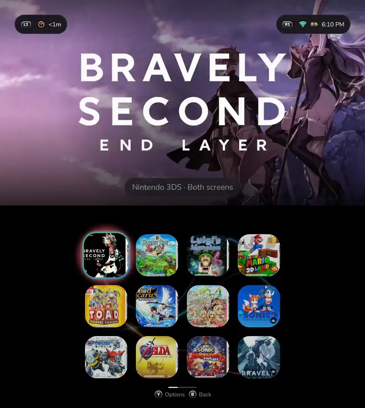
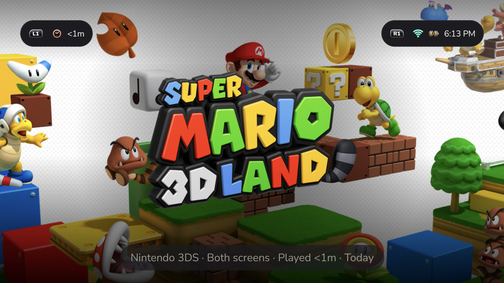
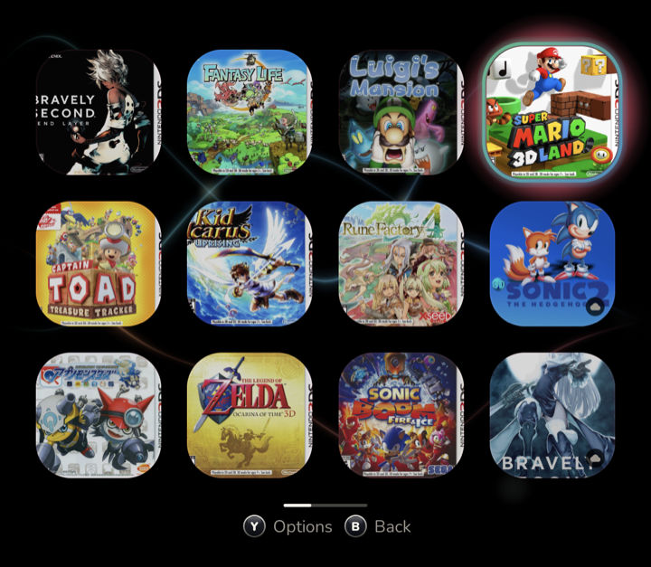
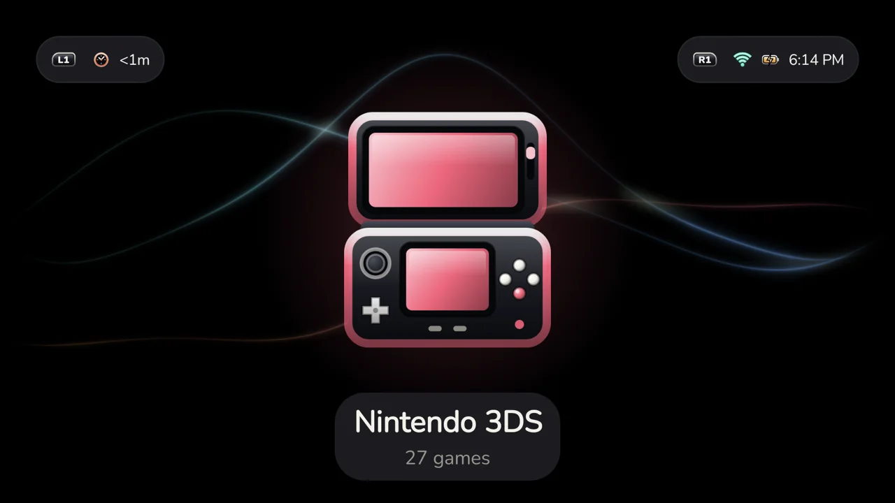
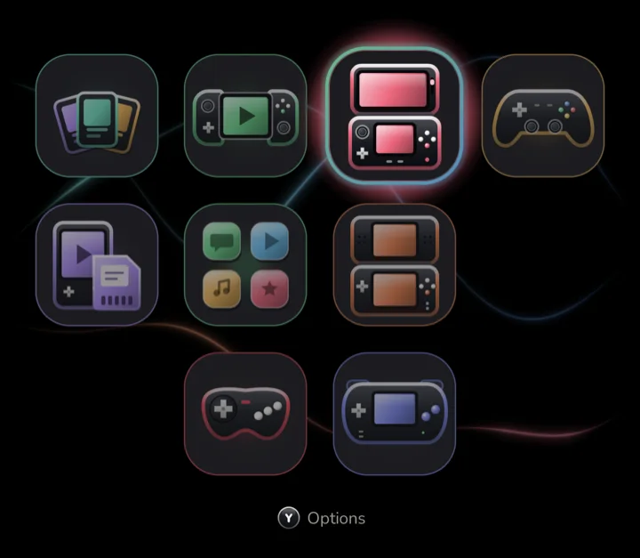
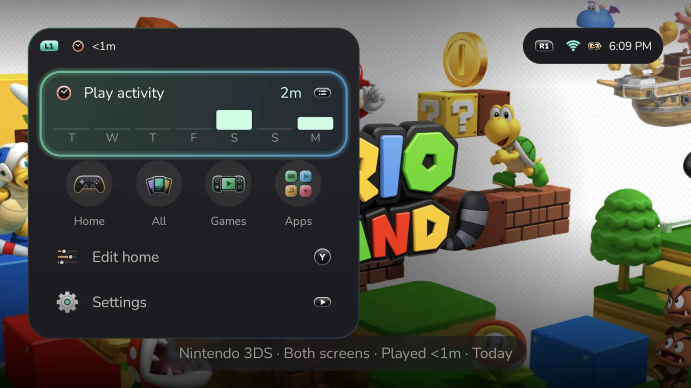
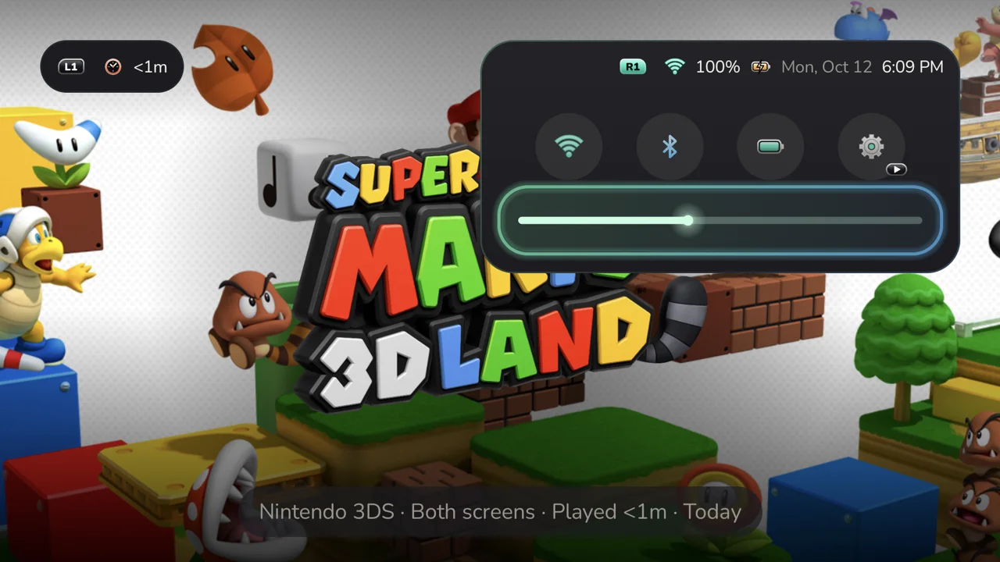
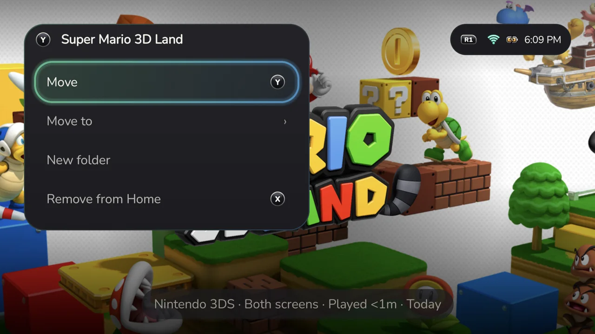
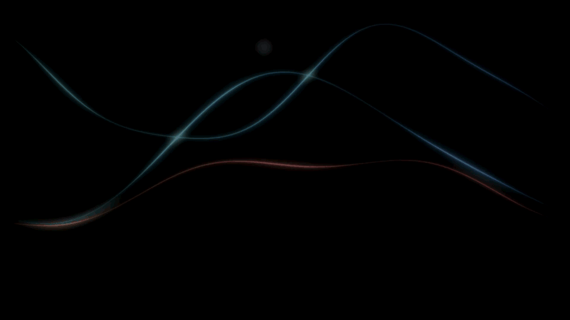
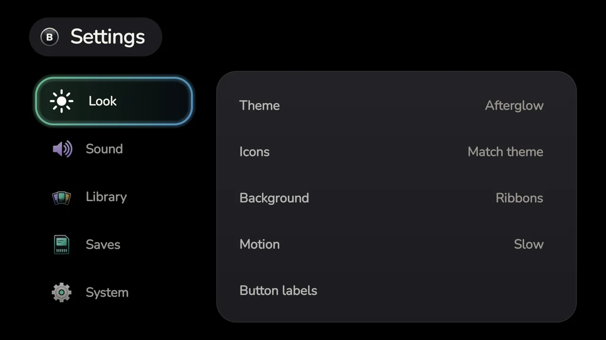

# Foldcade

**A calm, two-screen home for your AYN Thor.**

Open the clamshell and your collection is waiting: browse on the bottom screen while the selected game's art fills the top. Pick a game, and Foldcade steps aside.

Free and open source, with no ads, store, feeds, or required Foldcade account.

<!--
Hero clip and pair. Captured on a real Thor over adb, not an emulator.
The clip stacks both screens' screenrecords; the pair is one focused game.
Keep the hero-top.png and hero-bottom.png paths.
-->

  

<em>Captured on a real Thor. Move on the bottom screen, and the top screen becomes the game.</em>

[Get Foldcade](#get-foldcade) · [Add your games](docs/integrations/README.md)

## What you get

### Every game looks like itself

| Top screen | Bottom screen |
| :---: | :---: |
|  |  |

Move with the D-pad across a continuous shelf of box art. The selected game fills the top screen with wide art and a logo, or its cover beside a title-screen image.

Art comes from RomM, Steam, libretro, and an optional SteamGridDB key. With a key saved, choose **Y › Art** on a game to browse tile art, heroes, and logos. L1/R1 switch kinds, L2/R2 change the matched game, A saves an image, X restores automatic art for that kind, and B returns Home. The top screen names the SteamGridDB match. Image choices and chosen matches stay with the game across restarts. See [artwork setup](docs/integrations/README.md#artwork) to configure downloads.

### Everything in one place

| Top screen | Bottom screen |
| :---: | :---: |
|  |  |

Combine any of these sources in one home. Systems and sources get their own folders; emulators and streaming apps live in **Emulators**.

- **[Local games](docs/integrations/local-games.md):** ROMs on internal storage or an SD card.
- **[RomM](docs/integrations/romm.md):** Collections from one or more home servers.
- **[Android](docs/integrations/android.md):** Installed games and apps.
- **[GameNative](docs/integrations/gamenative.md):** Steam games installed on your Thor.
- **[DroidDeck](docs/integrations/droiddeck.md):** Games running in its on-device Steam client.
- **[Moonlight](docs/integrations/moonlight.md):** Games streamed from your computer.

See the [integration guides](docs/integrations/README.md) for setup and troubleshooting, and the [emulator guide](docs/integrations/emulators.md) for supported apps and formats.

### One press, and you are playing

Press **A** to play on the top screen or **X** on the bottom. Games that need both screens get both. Foldcade opens the appropriate app; when several emulators support a system, it uses the first installed one on its list.

### Two drawers, always a press away

| L1: your Foldcade | R1: your Thor |
| :---: | :---: |
|  |  |

**L1** opens Home, All, Games, Apps, Edit home, and Settings. **Start** opens Settings from the grid and closes it again. **Select** opens Find. **L2 / R2** jump letters in All (when sorted A–Z), the Android shelves, and Hidden, with a brief letter on the top screen; on Home, inside folders and inside collections they move one screen (four columns) at a time. Stick clicks do nothing. The Android Home button closes a folder, All, or a shelf and returns to its Home tile. **R1** gives you Wi-Fi, Bluetooth, battery, brightness for both screens, and notifications you can open or clear.

### Tidy up with one button

Press **Y** on any tile for what it can do. Press Y twice to pick up a tile, walk it with the D-pad, and press Y or A to put it down; B puts it back. Carried over a collection, a game waits there: **A** or **Y** adds it, and the D-pad walks on past. While you hold a game in a folder or collection, push **Up** from the top row to raise it to the Home target, then **A** or **Y** carries it onto Home still in your hand. From a folder it stays in the folder and becomes a pin. From a collection it leaves the collection. **New collection** is **Y** on an empty Home slot, on the All tile, or the last row of **Add to ›**. **Select** in the Y menu checks several tiles with **A**, then **Y** to **Add to**, **New collection**, **Pin to Home**, **Favorite**, or **Hide** them at once, with one Undo. **Tidy**, on an empty slot, closes the gaps.

- **Folders** are Foldcade's own, one for each system and source. Each always holds every game of its kind on Home, so a game you file elsewhere never goes missing from its folder.
- **Collections** are yours. Name them on an on-screen keyboard made for the controller, with quick names like Playing and Backlog one press away, and put a game in as many as you like with **Add to**. Adding a game to a collection leaves it in its folder. A collection is a glossy folder card, so it never looks like one of Foldcade's folders: **Y › Icon** opens an editor on the top screen with ten colors and a glyph for every kind of collection (star, trophy, sword, ghost, hourglass, and more, plus every system). The tile and the preview wear each choice as you move; **A** keeps it, **B** puts the old look back, and **L1**/**R1** change the color from anywhere.
- **Pin to Home** puts a shortcut to a game on Home itself. **Unpin** takes only the shortcut away.
- **Favorite** a game and **Favorites** appears on Home. **Recently played** shows up after you play something and lists your last 12 games, newest first.
- **Hide** takes a game off Home everywhere and keeps its games, downloads, and Android shortcuts intact.

During **Select**, the D-pad moves, **A** checks or clears a game, **Y** opens Actions, and **B** finishes without changing anything. A mixed collection check means some are already members; choosing it adds the rest. One Undo restores a batch hide.

### Hiding and bringing things back

Open **L1 › Edit home › Hidden** for hidden games, apps, emulators, streams, and folders removed from Home. The grid is alphabetical; **L2/R2** jumps between letters. Press **Y** on an item, then **Y** again for **Show**. A game returns to its old folder slot when free, its Home pin, and every collection it was in. A removed folder returns to its old Home slot when free.

After **Hide**, **Unpin**, **Remove**, or **Tidy**, the hint bar offers **Y Undo** for eight seconds. Press Y, then A on the first **Undo** row to restore that removal. Opening a menu with Undo pauses its remaining time until the menu closes. Undo is available even when the removal leaves the view empty; saving an edit removes its menu row. Games discovered meanwhile keep their places. Only the last removal can be undone; saving another edit clears it. Y twice still means **Move**.

**Delete download** and **Delete shortcut** require holding **A** for 0.8 seconds while their row fills. Release early to cancel. Where the row has an X shortcut, hold X after opening the Y menu instead. **Delete shortcut** removes a Moonlight or DroidDeck shortcut from Android and Home; **Hide** lets you bring it back through Hidden.

Android shelves share Hide and Show with the Home folders. **Pin to Home** puts a tile on Home; the shelf's **Keep on top** switch keeps an app first on its shelf. **Move to Android Games/Apps** changes its classification and has no Y chord.

### Find anything with Select

Press **Select** on any grid and start typing on the controller keyboard. Results line up above the keys as you type, with the best match's art on the top screen and where it lives on Home under its name. A few letters are enough: "ze" finds Zelda, "oot" finds Ocarina of Time, and one wrong letter is forgiven. With nothing typed, Find lists what you played last. **L2 / R2** filter to games, apps, collections, hidden items, recent play, or one system. Hidden includes games, shelf-hidden apps and emulators, and removed folders. Press **Up** or **Start** to reach the results, then **A** or **X** to play, or **Y** for the game's menu, where **Show on Home** takes you to its tile, opening its folder or collection on the way. **Show on Home** is in All's Y menu too. Hidden results offer **Show** on the Y chord to restore their saved places. **Hide** from Find uses the same Undo window as Home. **B** clears what you typed, then closes Find.

### The other screen stays useful

During a single-screen game, the other display shows a dim command center with the time, battery, game art, and RetroAchievements progress for RomM games. Press a button to wake it or open a second app there.

### Your saves follow you

With RomM 5.4 or newer and a [supported save setup](docs/integrations/romm.md#save-sync), Foldcade syncs saves with your server. Offline changes wait for a later sync. If copies conflict, you choose which to play and both are kept. Tile badges show download and sync progress.

### See where the hours went

Track how long you played and when, see your week in L1, and sort All by **Recent** to return to a game. **Library** sorts All A–Z; **Recent** puts the most recently played games first, followed by unplayed games A–Z. In Recent order, L2 / R2 move four columns at a time. **Settings › Library › Play time › Everywhere** also counts sessions started outside Foldcade.

### Make it yours

- **Afterglow:** True black and soft neon tiles, with drifting ribbons, embers, a still background, or plain black. Adjust the motion speed in Settings.
- **Music:** Lanternlight, an original track, plays while you browse and fades when you launch a game. Adjust its volume or turn it off.

## Get Foldcade

Foldcade is early and in active development. It is built for the Thor, and RetroArch is not supported yet.

Install with **Obtainium** to get automatic updates.

1. Install [Obtainium](https://obtainium.imranr.dev) on your Thor.
2. Tap the badge below on your Thor. Obtainium opens with Foldcade ready to add.
3. Add Foldcade, then install it.

Would rather install it by hand? Download `foldcade.apk` from [Releases](https://github.com/predmore/foldcade/releases) and open it on your Thor.

For preview features, enable [test builds](docs/releases.md#include-pre-releases).

## Questions

**Does it come with games?**
No. Foldcade organizes and opens the games you already have.

**Will it replace my Android home screen?**
Only if you want it to. You can open Foldcade like any other app, or choose **Set as Home** in Settings › System so it is the first thing you see. You can switch back any time.

**Does Foldcade keep my password?**
No. RomM sign-in uses a token, and Foldcade does not store your password.

## License and credits

Foldcade's original code, artwork, and music are open source under [MIT](LICENSE) ([licensing](docs/licensing.md)).

Credits for the home music and the theme art are in [licenses/CREDITS.md](licenses/CREDITS.md). Afterglow's original art, sounds, and shaders are licensed under [MIT](themes/afterglow/LICENSE). Its display face is Nunito Regular under the [SIL Open Font License](themes/afterglow/OFL-Nunito.txt). The resource-theme format, composition rules, and native preview are in the [theme author guide](docs/themes.md).

Game names and artwork in the screenshots belong to their owners and are shown only to illustrate how Foldcade displays your own library.

## For developers

- [Building](docs/building.md)
- [Plugins](docs/plugins.md)
- [Releases](docs/releases.md)
- [Architecture](docs/architecture.md)
- [Contributing](CONTRIBUTING.md)
